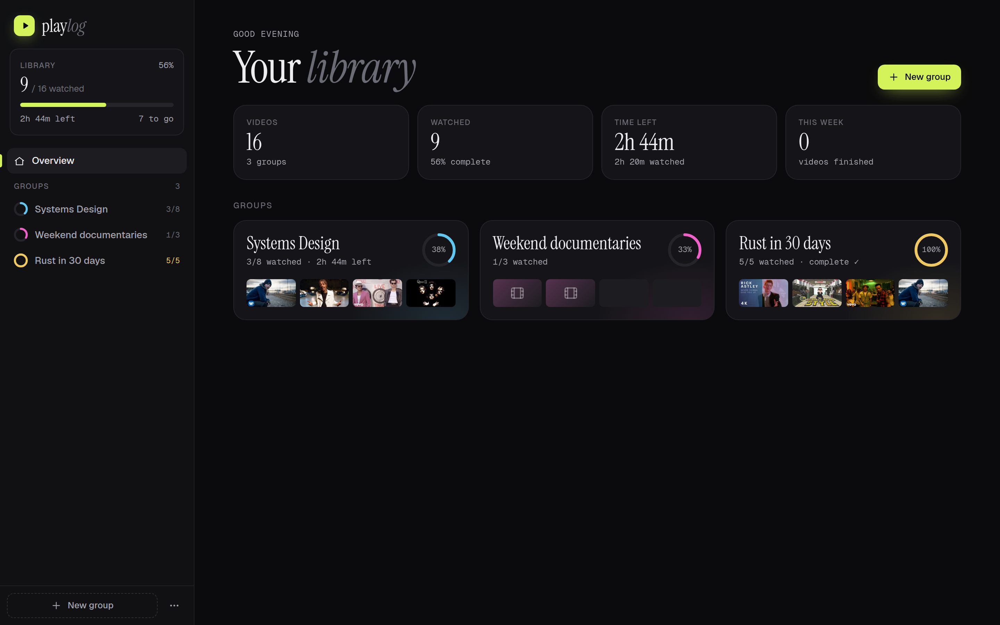
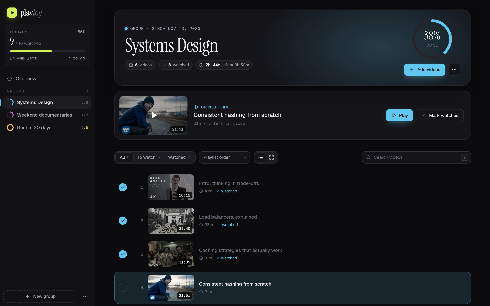
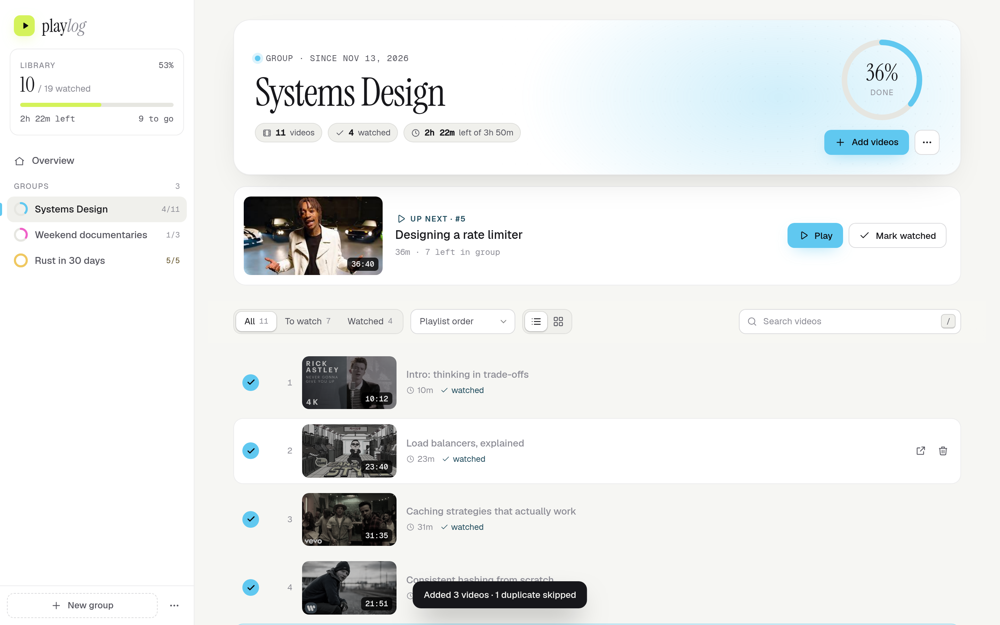
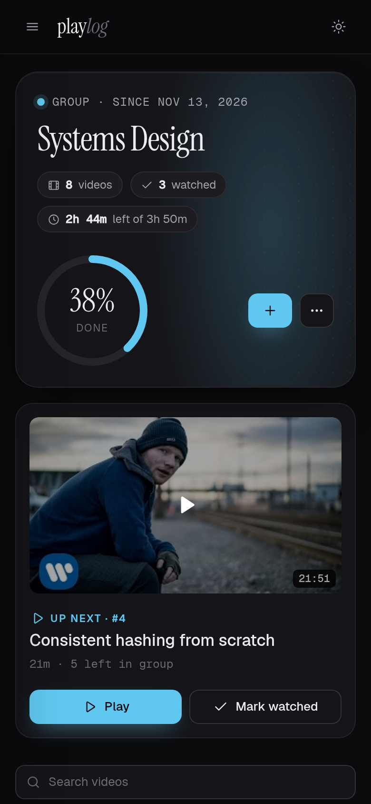

# playlog

A private video watchlist that runs in your browser. Group the videos you mean to watch, paste in whole YouTube playlists, and keep track of how much is left.

No account, no backend, no build step. It's one `index.html`, and your data stays in your browser's `localStorage`.



| Group view | Light mode | Mobile |
|---|---|---|
|  |  |  |

## Features

- **Groups** for courses, series, creators and so on. Each group has its own color.
- **Bulk add.** Paste titles, links, or a YouTube playlist URL, one per line. You can import only part of a playlist (for example `1-20, 40-60`). Videos already in the group are skipped.
- **Titles, channels and lengths are filled in automatically** for YouTube links, including `youtu.be`, `/shorts/` and `/live/` links.
- **Up next.** The next unwatched video gets its own card with Play and Mark watched buttons.
- **Progress** shown as rings and bars, with time watched, time left, and videos finished this week.
- **List and grid views.** Filter by watched or unwatched, search, and sort by playlist order, title, length or most recently watched.
- **Undo** for deleting a video, deleting a group, mark all and reset.
- **Backup.** Export and import your library as JSON.
- **Light and dark themes**, a responsive layout with a slide-out sidebar on mobile, and support for reduced motion.
- **Multiple tabs stay in sync.**

### Keyboard shortcuts

| Key | Action |
|---|---|
| `/` | Search |
| `N` | New group |
| `A` | Add videos |
| `P` / `D` | Play / mark the up-next video watched |
| `J` / `K` | Next / previous group |
| `H` | Library home |
| `V` | Toggle list / grid |
| `T` | Toggle theme |
| `?` | Show shortcuts |

## Run it

Open `index.html` in a browser. To serve it locally instead:

```sh
python3 -m http.server 8000   # then visit http://localhost:8000
```

It also works on GitHub Pages as-is.

## How metadata is fetched

There's no YouTube API key involved. Playlists and video lengths come from public [Invidious](https://invidious.io/) instances, with a fallback to a public YouTube Data API mirror. Titles and channel names come from [noembed](https://noembed.com/). These are community services, so they can be slow or unavailable now and then. If that happens, use **⋯ → Fetch missing titles & lengths** on the group to try again later.

## Data

Everything is stored in `localStorage` under the key `watchlist_v2`, the same key the original version used, so existing libraries load without any migration step. Clearing your browser's site data deletes your library, so export a backup now and then.
