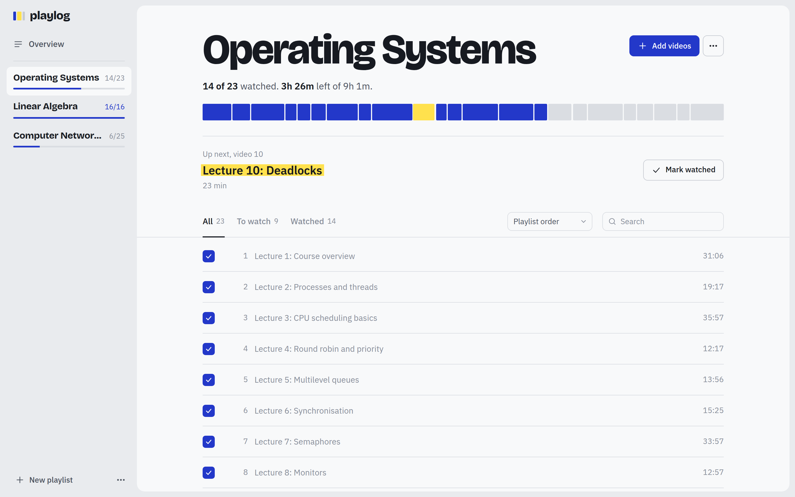

# playlog

Keep your place in long lecture playlists and video series. Paste a YouTube playlist and playlog shows what's next, what you skipped, and how much watching is left.



Each playlist has a **reel**: one block per video, sized by its length. Blue blocks are watched, the yellow block is up next, and grey blocks are still to watch. Click a block to jump to that video.

| Overview | Dark theme | Phone |
|---|---|---|
|  |  |  |

<sub>Screenshots use made-up demo data.</sub>

## Your data stays on your device

There is no server, account or database. Your playlists are saved in your browser's `localStorage` and never leave your device. The public site only serves the app's code. When someone else opens it, they start with an empty app in their own browser and can't see your playlists.

The app sends YouTube video IDs to public metadata services, but only when it's looking up titles and lengths (see below).

Because the data lives in one browser:
- To move it to another browser or device, use **⋯ → Download a backup**, then **Import a backup** on the other one. You can also drag the backup file onto the page.
- Clearing the browser's site data deletes your playlists, so keep a backup.

## Features

- Paste YouTube playlist links, single video links (`youtu.be`, `/shorts/`, `/live/`) or plain titles, one per line.
- Add only part of a playlist, for example `1-20, 35-40`. Videos that are already in the playlist are skipped.
- Titles, channels and lengths are filled in automatically.
- See the next unwatched video, with Play and Mark watched buttons.
- Filter, search, and sort by playlist order, recently watched or length.
- Undo after removing a video, deleting a playlist, marking everything watched or resetting progress.
- Light and dark themes, a phone layout, and support for reduced-motion settings.
- Keyboard shortcuts: `/` to search, `P` to play the next video, `D` to mark it watched, `A` to add videos, `J`/`K` to switch playlists, `?` to list them all.

## Run it

Open `index.html` in a browser, or serve the folder:

```sh
python3 -m http.server 8000
```

## Where titles and lengths come from

There's no YouTube API key. Playlists and video lengths come from public [Invidious](https://invidious.io/) servers, with a public YouTube Data API mirror as a fallback. Titles and channel names come from [noembed](https://noembed.com/). These are community services and are sometimes down. If titles or lengths are missing, use **⋯ → Fill in missing titles and lengths** later.
