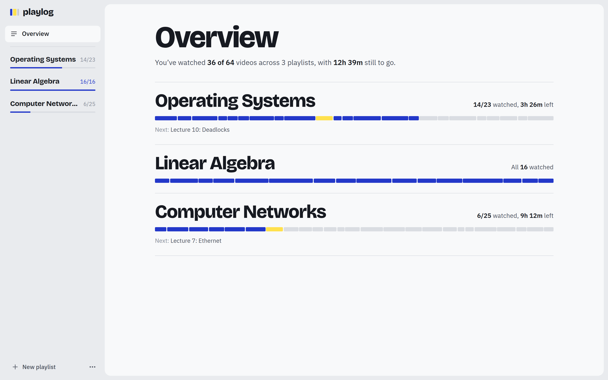
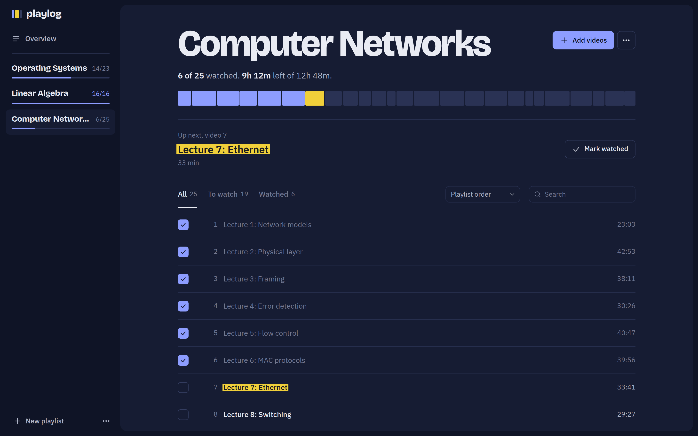
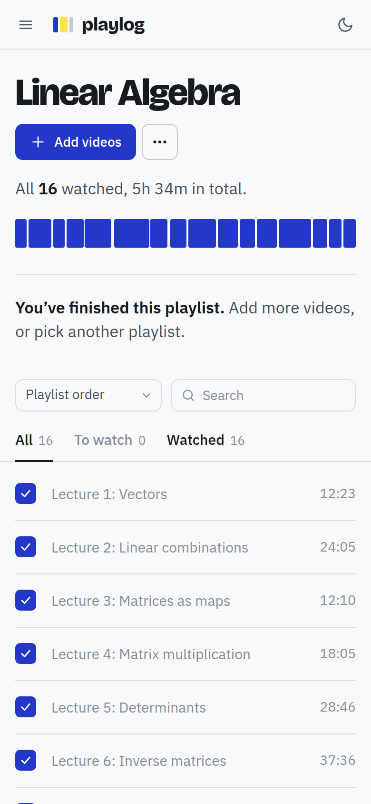

# playlog

Keep your place in long lecture playlists and video series. Paste a YouTube playlist and playlog shows what's next, what you skipped, and how much watching is left.


Each playlist has a **reel**: one block per video, sized by its length. Blue blocks are watched, the yellow block is up next, and grey blocks are still to watch. Click a block to jump to that video.

| Overview | Dark theme | Phone |
|---|---|---|
|  |  |  |

<sub>Screenshots use made-up demo data.</sub>

## Your data and sync

There's no playlog server. By default your playlists are saved in your browser's `localStorage` and never leave your device. The public site only serves the app's code, so other people who open it start with an empty app and can't see your playlists.

To use the same playlists on several devices, you can turn on **Sign in with Google**. Accounts and data are stored in a free [Firebase](https://firebase.google.com/) project that you own. Each account's playlists are saved as a single document, and the rules in [`firestore.rules`](firestore.rules) only let that account read or write it. The app keeps working offline and syncs when it reconnects.

Without sync, use **⋯ → Download a backup** and **Import a backup** (or drag the file onto the page) to move playlists between devices. Clearing the browser's site data deletes playlists that aren't synced.

The app sends YouTube video IDs to public metadata services, but only when it's looking up titles and lengths (see below).

### Turn on sync (about 5 minutes)

1. Go to the [Firebase console](https://console.firebase.google.com/) and click **Create a project**. You can turn off Google Analytics.
2. Open **Build → Authentication → Get started**. Under **Sign-in method**, enable **Google** and pick a support email.
3. Under **Authentication → Settings → Authorized domains**, add the domain the site is served from, for example `yourname.github.io`.
4. Open **Build → Firestore Database → Create database**. Pick a location and start in **production mode**.
5. In Firestore, open the **Rules** tab, replace the rules with the contents of `firestore.rules`, and click **Publish**.
6. Open **Project settings** (the gear icon). Under **Your apps**, click the web icon (`</>`) and register an app. Firebase shows a `firebaseConfig` object.
7. Paste that object into `sync-config.js`:
   ```js
   window.PLAYLOG_FIREBASE = {
     apiKey: "…",
     authDomain: "….firebaseapp.com",
     projectId: "…",
     appId: "…",
   };
   ```
   Commit and push the file. These values only identify the project and are safe to publish. The security rules protect the data.
8. Open playlog and click **Sign in with Google** at the bottom of the sidebar. Playlists already on that device are saved to your account. Sign in on your other devices to load them there.

Sign-in needs the site to be served over http(s). It doesn't work when you open `index.html` as a local file.

If a device already has playlists when you sign in, they're combined with the ones in your account. After that, the most recent change wins.

## Features

- Paste YouTube playlist links, single video links (`youtu.be`, `/shorts/`, `/live/`) or plain titles, one per line.
- Add only part of a playlist, for example `1-20, 35-40`. Videos that are already in the playlist are skipped.
- Titles, channels and lengths are filled in automatically.
- See the next unwatched video, with Play and Mark watched buttons.
- Filter, search, and sort by playlist order, recently watched or length.
- Undo after removing a video, deleting a playlist, marking everything watched or resetting progress.
- Light and dark themes, a phone layout, and support for reduced-motion settings.
- Keyboard shortcuts: `/` to search, `P` to play the next video, `D` to mark it watched, `A` to add videos, `J`/`K` to switch playlists, `?` to list them all.

## Copy transcripts for notes

Each YouTube video has a copy button, also shown on the up next card, and each playlist has a **Copy transcripts** button for the videos in the current tab (All, To watch or Watched). What's copied starts with a notes prompt, which you can change under **⋯ → Notes prompt**, so you can paste it straight into Gemini or another assistant.

Browsers don't let a website read YouTube transcripts directly. To copy the actual transcript text, install the **transcript helper** userscript:

1. Install [Violentmonkey](https://violentmonkey.github.io/) (Firefox, Zen, Chrome, Edge, Firefox for Android) or Tampermonkey.
2. Open [`playlog-transcripts.user.js`](https://dakshhpanchal.github.io/playlog/playlog-transcripts.user.js) and click **Install**.
3. Reload playlog.

The helper runs only on the playlog site. It fetches the same transcript YouTube shows under "Show transcript", in your own browser. Without the helper, or for videos without captions, playlog copies the prompt with the video links instead. Gemini can read YouTube videos from a link.

## Run it

Open `index.html` in a browser, or serve the folder:

```sh
python3 -m http.server 8000
```

## Where titles and lengths come from

There's no YouTube API key. Playlists and video lengths come from public [Invidious](https://invidious.io/) servers, with a public YouTube Data API mirror as a fallback. Titles and channel names come from [noembed](https://noembed.com/). These are community services and are sometimes down. If titles or lengths are missing, use **⋯ → Fill in missing titles and lengths** later.
